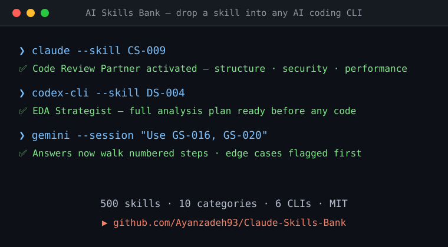

<p align="center">
  
</p>

<h1 align="center">🧠 بانک مهارت‌های هوش مصنوعی</h1>

<p align="center">
  <a href="README.md">English</a> · فارسی
</p>

<p align="center">
  <strong>۵۰۰ مهارت قابل‌استفادهٔ دوباره برای هوش مصنوعی — آماده برای Claude Code، Codex CLI، Gemini CLI، Kimi CLI، Aider و بقیه</strong>
</p>

<p align="center">
  <a href="#quick-start"></a>
  <a href="#categories"></a>
  <a href="#platforms"></a>
  <a href="LICENSE"></a>
  <a href="skills.json"></a>
  <a href="https://github.com/Ayanzadeh93/Claude-Skills-Bank/actions/workflows/validate-skills.yml"></a>
</p>

<p align="center">
  <a href="#categories">دسته‌ها</a> •
  <a href="#platforms">بسترها</a> •
  <a href="#quick-start">شروع سریع</a> •
  <a href="#usage">کاربرد</a> •
  <a href="#json-index">نمایهٔ JSON</a> •
  <a href="#contributing">مشارکت</a> •
  <a href="ROADMAP.md">نقشهٔ راه</a>
</p>

ترجمهٔ [README.md](README.md). شناسه‌های مهارت، دستورها و نمونهٔ کدها عمداً انگلیسی مانده‌اند تا همان متنی باشند که در مخزن کپی می‌کنید.

---

## ✨ این چیست؟

کتابخانه‌ای گزینش‌شده از **۵۰۰ «مهارت» هوش مصنوعی**: نقش‌ها، رفتارها و قالب‌های درخواستی که می‌توانید در گردش کار، محصول و عامل‌های خود بگذارید. هر مهارت این‌ها را دارد:

- 🆔 **شناسه** — شناسهٔ ثابت برای مسیریابی و مستندات (مثلاً `CS-012`)
- 📛 **نام** — نام خوانا برای تشخیص سریع
- 📝 **شرح** — یک خط توصیفِ قابلِ اجرا

> **اول برای Claude ساخته شد و حالا برای هر CLI بزرگ کدنویسی با هوش مصنوعی سازگار شده است.**

### 🎬 در عمل ببینید

<p align="center">
  
</p>

### 🥇 مقایسه

چرا این را بردارید، نه یک فهرست سادهٔ درخواست؟

| | **بانک مهارت‌های هوش مصنوعی** | فهرست‌های `awesome-*` | بازارچه‌های درخواست |
|:--|:--|:--|:--|
| شناسهٔ ثابت و مستند (`CS-009`) | ✓ | — | — |
| پیکربندی آماده برای ۶ CLI | ✓ | — | ناقص |
| زنجیره و الگوی مسیریابی مهارت | ✓ | — | — |
| خودمیزبان، بدون ثبت‌نام، MIT | ✓ | ✓ | — |
| قالب‌های گزینش‌شده و بازبینی‌شده توسط انسان | ✓ | ✓ | ✓ |

---

## <a id="quick-start"></a>🚀 شروع سریع

### ⚡ شروع سی‌ثانیه‌ای

```bash
git clone https://github.com/Ayanzadeh93/Claude-Skills-Bank
# then open the category that matches your task, e.g.
open skills/skills-coding.md          # macOS    (Windows: start skills/skills-coding.md)
```

هر مهارت را در پروندهٔ زمینهٔ CLI خود بگذارید (`CLAUDE.md`، `AGENTS.md`، `GEMINI.md` و مانند این‌ها) تا همان لحظه اثر کند. نصب، ساخت و ثبت‌نام لازم نیست.

### ۱. یک مهارت بردارید

[دسته‌های پایین](#categories) را ببینید، یا پرونده‌های داخل [`skills/`](skills/).

### ۲. بستر را انتخاب کنید

| بستر | پروندهٔ پیکربندی | پوشه |
|:---------|:------------|:----------|
| 🟣 **Claude Code** | `CLAUDE.md` | [`platforms/claude-code/`](platforms/claude-code/) |
| 🟢 **Codex CLI** | `~/.agents/skills/` | [`platforms/codex-cli/`](platforms/codex-cli/) |
| 🔵 **Gemini CLI** | `GEMINI.md` | [`platforms/gemini-cli/`](platforms/gemini-cli/) |
| 🌙 **Kimi CLI** | دستورهای سفارشی | [`platforms/kimi-cli/`](platforms/kimi-cli/) |
| 🟡 **Aider** | `.aider.conf.yml` | [`platforms/aider/`](platforms/aider/) |
| 🔶 **Cline** | دستورهای سفارشی | [`platforms/cline/`](platforms/cline/) |

### ۳. به کار ببرید

**به‌عنوان نقشِ درخواستِ سیستم:**

```
You are CS-003 – Refactoring Specialist.
Refactor code for readability and maintainability while preserving behavior.
```

**به‌عنوان رفتار عامل:**

```
Route coding tasks to CS-001–CS-050.
Route data analysis tasks to DS-001–DS-050.
```

**به‌عنوان دستور داخل CLAUDE.md:**

```markdown
## Active Skills
- Use GS-016 ("Think Step by Step" Enforcer) for all complex tasks
- Use CS-009 (Code Review Partner) for all PRs
- Use GS-020 (Risk & Edge-Case Spotter) before merging
```

---

## <a id="categories"></a>📂 دسته‌ها

| | پیشوند | بازه | دسته | پرونده |
|:-:|:------:|:-----:|:---------|:------------|
| 🎯 | `GS` | 001–050 | **مهارت‌های عمومی و فرا** | [`skills-general-meta.md`](skills/skills-general-meta.md) |
| 💻 | `CS` | 001–050 | **کدنویسی و بازبینی کد** | [`skills-coding.md`](skills/skills-coding.md) |
| 📊 | `DS` | 001–050 | **داده، تحلیل و ریاضی** | [`skills-data-analysis.md`](skills/skills-data-analysis.md) |
| 🔬 | `RS` | 001–050 | **پژوهش و خواندن** | [`skills-research-reading.md`](skills/skills-research-reading.md) |
| ✍️ | `WS` | 001–050 | **نوشتن و ویرایش** | [`skills-writing-editing.md`](skills/skills-writing-editing.md) |
| 📦 | `PS` | 001–050 | **محصول، تجربهٔ کاربر و کسب‌وکار** | [`skills-product-ux-business.md`](skills/skills-product-ux-business.md) |
| 🎓 | `ES` | 001–050 | **آموزش و تدریس** | [`skills-education-teaching.md`](skills/skills-education-teaching.md) |
| 💡 | `CR` | 001–050 | **خلاقیت و ایده‌پردازی** | [`skills-creativity-ideation.md`](skills/skills-creativity-ideation.md) |
| ⚙️ | `OS` | 001–050 | **عملیات و بهره‌وری** | [`skills-operations-productivity.md`](skills/skills-operations-productivity.md) |
| ♿ | `AS` | 001–050 | **دسترسی‌پذیری، بینایی و چندرسانه‌ای** | [`skills-accessibility-multimodal.md`](skills/skills-accessibility-multimodal.md) |

---

## <a id="platforms"></a>🔌 بسترهای پشتیبانی‌شده

<details>
<summary><strong>🟣 Claude Code</strong> — ابزار کدنویسی عاملیِ ترمینال Anthropic</summary>

### راه‌اندازی

مهارت‌ها را در `CLAUDE.md` پروژه یا در `~/.claude/CLAUDE.md` سراسری بگذارید:

```markdown
# Skills Configuration

## Active Skills
When performing code review, activate:
- CS-009 – Code Review Partner
- CS-011 – Secure Coding Checker
- GS-020 – Risk & Edge-Case Spotter

## Behavioral Rules
- Always use GS-016 ("Think Step by Step" Enforcer)
- For documentation tasks, use CS-005 (Documentation-First Coder)
```

**امکان‌های اصلی:** زمینهٔ یک‌میلیون توکنی، حافظهٔ سلسله‌مراتبی (`CLAUDE.md`)، گردش کار بومی Git.

📁 **پیکربندی آماده → [`platforms/claude-code/`](platforms/claude-code/)**

</details>

<details>
<summary><strong>🟢 Codex CLI</strong> — ابزار کدنویسی عاملیِ ترمینال OpenAI</summary>

### راه‌اندازی

تعریف مهارت‌ها را در `~/.agents/skills/` بگذارید یا در درخواست سیستم بیاورید:

```markdown
# Skill: CS-003 – Refactoring Specialist
## Behavior
Refactor code for readability and maintainability while preserving behavior.
## Rules
- Preserve all existing tests
- Suggest new tests for refactored code
- Explain each refactoring decision
```

**امکان‌های اصلی:** هماهنگی چندعاملی، جعبه‌شن ابری، مدیریت چرخهٔ عمر Git.

📁 **پیکربندی آماده → [`platforms/codex-cli/`](platforms/codex-cli/)**

</details>

<details>
<summary><strong>🔵 Gemini CLI</strong> — عامل ترمینال متن‌باز گوگل</summary>

### راه‌اندازی

مهارت‌ها را به پروندهٔ زمینهٔ `GEMINI.md` پروژه اضافه کنید:

```markdown
# Project Skills

## Code Quality Skills
Apply CS-009 (Code Review Partner) with these rules:
- Flag complexity > 10
- Require docstrings for public functions
- Check for security patterns (CS-011)

## Analysis Skills
For data tasks, use DS-004 (EDA Strategist) workflow.
```

**امکان‌های اصلی:** یکپارچگی MCP، استدلال Gemini 3، چند حالت خودمختاری.

📁 **پیکربندی آماده → [`platforms/gemini-cli/`](platforms/gemini-cli/)**

</details>

<details>
<summary><strong>🌙 Kimi CLI</strong> — عامل کدنویسی ترمینال‌محور Moonshot AI</summary>

### راه‌اندازی

به‌عنوان دستور سفارشی یا درخواست سیستم:

```markdown
# Active Skills Configuration
## Development Workflow
- Planning: GS-004 (Task Decomposer) + GS-005 (Planning & Execution Orchestrator)
- Coding: CS-003 (Refactoring Specialist) + CS-006 (Test Case Generator)
- Review: CS-009 (Code Review Partner)
```

**امکان‌های اصلی:** هماهنگی ازدحام عامل‌ها، پشتیبانی ACP/MCP، حالت یکپارچه با پوسته.

📁 **پیکربندی آماده → [`platforms/kimi-cli/`](platforms/kimi-cli/)**

</details>

<details>
<summary><strong>🟡 Aider</strong> — برنامه‌نویس جفتِ متن‌باز و Git‌محور</summary>

### راه‌اندازی

مهارت‌ها را در `.aider.conf.yml` بیاورید یا به‌عنوان درخواست سیستم بدهید:

```yaml
# .aider.conf.yml
model: claude-sonnet-4-20250514
system-prompt: |
  You are operating with the following active skills:
  - CS-003: Refactoring Specialist
  - CS-006: Test Case Generator  
  - GS-016: "Think Step by Step" Enforcer
  Always apply these behaviors to every code change.
```

**امکان‌های اصلی:** مستقل از مدل، آگاه از نقشهٔ مخزن، ثبت خودکار، بیش از ۱۰۰ زبان.

📁 **پیکربندی آماده → [`platforms/aider/`](platforms/aider/)**

</details>

<details>
<summary><strong>🔶 Cline</strong> — عامل کدنویسی خودمختار برای VS Code</summary>

### راه‌اندازی

مهارت‌ها را به‌عنوان دستور سفارشی در تنظیمات Cline بگذارید:

```markdown
# Custom Instructions — Active Skills

## Always Apply
- GS-016: Structure all solutions as numbered reasoning steps
- CS-009: Perform code review before submitting changes
- GS-020: List failure modes and edge cases for every change

## On Request
- CS-006: Generate unit tests when asked
- CS-031: Help with Docker when containerization is needed
```

**امکان‌های اصلی:** بومی VS Code، خودکارسازی مرورگر، پشتیبانی MCP، چند مدل.

📁 **پیکربندی آماده → [`platforms/cline/`](platforms/cline/)**

</details>

---

## <a id="usage"></a>🎯 الگوهای کاربرد

### الگوی ۱: مسیریابی مهارت

کار را بر اساس محتوا به مهارت تخصصی بفرستید:

```
IF task contains code → route to CS-001–CS-050
IF task is about data → route to DS-001–DS-050
IF task is writing → route to WS-001–WS-050
```

### الگوی ۲: چیدن مهارت‌ها روی هم

برای کار پیچیده چند مهارت را با هم به کار ببرید:

```
Task: "Review this PR for production readiness"

Stack:
  1. CS-009 – Code Review Partner (structure the review)
  2. CS-011 – Secure Coding Checker (security audit)
  3. CS-010 – Performance Profiler (bottleneck check)
  4. CS-006 – Test Case Generator (suggest missing tests)
  5. GS-020 – Risk & Edge-Case Spotter (final risk check)
```

### الگوی ۳: زنجیرهٔ مهارت

خط لولهٔ پشت‌سرهم بسازید:

```
Task: "Write a blog post about our new API"

Chain:
  WS-015 (Blog Post Planner)
    → WS-009 (Outline-to-Draft Expander)
      → WS-004 (Coherence & Flow Editor)
        → WS-005 (Clarity & Brevity Editor)
          → WS-016 (Blog Post SEO Assistant)
```

### الگوی ۴: فعال‌کردن شخصیت

برای نشست یک شخصیت پایدار بگذارید:

```markdown
# Session Persona: Senior Code Reviewer

Active Skills:
- GS-006 (Constraint Enforcer) — enforce style guide
- CS-009 (Code Review Partner) — structured review
- CS-011 (Secure Coding Checker) — security focus
- GS-044 (Traceability Enforcer) — cite evidence for every comment
```

---

## <a id="json-index"></a>🧩 دسترسی برنامه‌ای

[`skills.json`](skills.json) نمایهٔ ماشین‌خوان هر ۵۰۰ مهارت است، برای عامل‌ها، افزونه‌های ویرایشگر و رابط‌های فهرست.

```json
{
  "schemaVersion": 1,
  "total": 500,
  "categories": [{ "name": "Coding & Code Review", "prefix": "CS", "file": "skills/skills-coding.md", "count": 50 }],
  "skills": [
    {
      "id": "CS-009",
      "name": "Code Review Partner",
      "description": "Performs a human-style code review with comments and priority labels.",
      "category": "Coding & Code Review",
      "file": "skills/skills-coding.md"
    }
  ]
}
```

با [`jq`](https://jqlang.github.io/jq/) پرس‌وجو کنید:

```bash
# every coding skill
jq -r '.skills[] | select(.category | test("Coding")) | "\(.id)\t\(.name)"' skills.json

# one skill by ID
jq '.skills[] | select(.id == "CS-009")' skills.json

# all IDs, for agent routing tables
jq -r '.skills[].id' skills.json | paste -sd ' '
```

بعد از ویرایش یک پروندهٔ مهارت، نمایه را دوباره بسازید:

```bash
node scripts/build-skills-json.mjs          # rewrite skills.json
node scripts/build-skills-json.mjs --check  # CI mode: fail if stale or invalid
```

CI همین بررسی را روی هر درخواست ادغام اجرا می‌کند: شناسهٔ یکتا، پیشوند درست، بازهٔ پیوستهٔ `001–050`، و نبودن اختلاف دستی بین مارک‌داون و `skills.json`.

---

## 📁 ساختار مخزن

```
📦 AI-Skills-Bank
├── 📄 README.md                          ← You are here
├── 📄 README.fa.md                       ← Persian translation
├── 📄 LICENSE                            ← MIT License
├── 📄 CONTRIBUTING.md                    ← How to contribute
├── 📄 PLATFORMS.md                       ← Cross-platform comparison guide
├── 📄 CHANGELOG.md                       ← Version history
├── 📄 ROADMAP.md                         ← Where the project is going
├── 📄 skills.json                        ← Machine-readable index of all 500 skills
├── 📂 assets/                            ← Repo assets (banner, demo, images)
│   ├── 📄 banner.svg
│   └── 📄 demo.svg
├── 📂 scripts/                           ← Tooling
│   └── 📄 build-skills-json.mjs
├── 📂 .github/workflows/                 ← CI
│   └── 📄 validate-skills.yml
├── 📂 skills/                            ← 📚 Master skill definitions
│   ├── 📄 skills-general-meta.md
│   ├── 📄 skills-coding.md
│   ├── 📄 skills-data-analysis.md
│   ├── 📄 skills-research-reading.md
│   ├── 📄 skills-writing-editing.md
│   ├── 📄 skills-product-ux-business.md
│   ├── 📄 skills-education-teaching.md
│   ├── 📄 skills-creativity-ideation.md
│   ├── 📄 skills-operations-productivity.md
│   └── 📄 skills-accessibility-multimodal.md
└── 📂 platforms/                         ← 🔌 Platform-specific adaptations
    ├── 📂 claude-code/
    ├── 📂 codex-cli/
    ├── 📂 gemini-cli/
    ├── 📂 kimi-cli/
    ├── 📂 aider/
    └── 📂 cline/
```

---

## <a id="contributing"></a>🤝 مشارکت

مشارکت خوشامد است. راهنما در [`CONTRIBUTING.md`](CONTRIBUTING.md) است و مسیر پروژه در [`ROADMAP.md`](ROADMAP.md).

**نمی‌دانید از کجا شروع کنید؟** بلیت‌های [`good first issue`](https://github.com/Ayanzadeh93/Claude-Skills-Bank/issues?q=is%3Aissue+is%3Aopen+label%3A%22good+first+issue%22) را ببینید: کارهایی کوچک و با محدودهٔ روشن.

**راه‌های مشارکت:**

- 🆕 پیشنهاد مهارت تازه
- ✏️ بهتر کردن شرح مهارت‌های موجود
- 🔌 افزودن سازگاری برای بستر تازه
- 📝 به اشتراک گذاشتن الگو و مثال
- 🐛 گزارش اشکال در تعریف مهارت‌ها

---

## 🛡️ جامعه و پشتیبانی

- پیش از مشارکت [منشور رفتار](CODE_OF_CONDUCT.md) را بخوانید.
- مسئلهٔ امنیتی را از راه [سیاست امنیتی](SECURITY.md) گزارش کنید.
- برای کمک، پرسش یا بازخورد، [پشتیبانی](SUPPORT.md) را ببینید.

---

## 📜 مجوز

این پروژه تحت [مجوز MIT](LICENSE) است.

---

## ⭐ تاریخچهٔ ستاره

[](https://star-history.com/#Ayanzadeh93/Claude-Skills-Bank&Date)

اگر این پروژه به گردش کار هوش مصنوعی شما کمک می‌کند، یک ⭐ بدهید تا دیگران هم مجموعه را پیدا کنند. نقشهٔ راه در [`ROADMAP.md`](ROADMAP.md) است.

---

## 🌐 ترجمه‌ها

- [English](README.md)
- [فارسی](README.fa.md)

---

<p align="center">
  <sub>ساخته‌شده با 🧠 توسط جامعه — برای زیست‌بوم عامل‌های هوش مصنوعی</sub>
</p>
