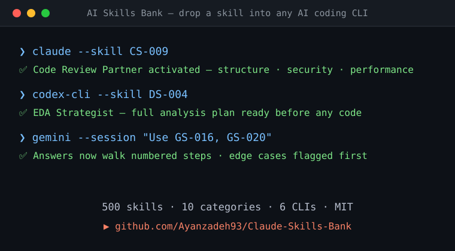

<p align="center">
  
</p>

<h1 align="center">🧠 AI Skills Bank</h1>

<p align="center">
  <strong>500 reusable AI skills — ready for Claude Code, Codex CLI, Gemini CLI, Kimi CLI, Aider & more</strong>
</p>

<p align="center">
  <a href="#-quick-start"></a>
  <a href="#-categories"></a>
  <a href="#-supported-platforms"></a>
  <a href="LICENSE"></a>
  <a href="skills.json"></a>
  <a href="https://github.com/Ayanzadeh93/Claude-Skills-Bank/actions/workflows/validate-skills.yml"></a>
</p>

<p align="center">
  <a href="#-categories">Categories</a> •
  <a href="#-supported-platforms">Platforms</a> •
  <a href="#-quick-start">Quick Start</a> •
  <a href="#-usage-patterns">Usage</a> •
  <a href="#-programmatic-access">JSON Index</a> •
  <a href="#-contributing">Contributing</a> •
  <a href="#-roadmap">Roadmap</a>
</p>

---

## ✨ What Is This?

A curated library of **500 AI "skills"** — reusable roles, behaviors, and prompt templates you can plug into your workflows, products, and agents. Each skill is:

- 🆔 **Identified** — Stable ID for routing and documentation (e.g., `CS-012`)
- 📛 **Named** — Human-readable name for quick recognition
- 📝 **Described** — One-line actionable description

> **Originally built for Claude, now adapted for every major AI coding CLI.**
### 🎬 See it in action

<p align="center">
  
</p>

### 🥇 How This Compares

Why reach for this instead of a plain prompt list?

| | **AI Skills Bank** | `awesome-*` prompt lists | Prompt marketplaces |
|:--|:--|:--|:--|
| Stable, documented skill IDs (`CS-009`) | ✓ | — | — |
| Ready-made configs for 6 AI CLIs | ✓ | — | partial |
| Skill chains and routing patterns | ✓ | — | — |
| Self-hosted, no signup, MIT | ✓ | ✓ | — |
| Curated, human-reviewed templates | ✓ | ✓ | ✓ |


---

## 🚀 Quick Start

### ⚡ 30-Second Start

```bash
git clone https://github.com/Ayanzadeh93/Claude-Skills-Bank
# then open the category that matches your task, e.g.
open skills/skills-coding.md          # macOS    (Windows: start skills/skills-coding.md)
```

Paste any skill into your CLI's context file (`CLAUDE.md`, `AGENTS.md`, `GEMINI.md` …) and it takes effect immediately. No install, no build, no signup.


### 1. Pick a Skill

Browse the [categories below](#-categories) or the files in [`skills/`](skills/).

### 2. Choose Your Platform

| Platform | Config File | Directory |
|:---------|:------------|:----------|
| 🟣 **Claude Code** | `CLAUDE.md` | [`platforms/claude-code/`](platforms/claude-code/) |
| 🟢 **Codex CLI** | `~/.agents/skills/` | [`platforms/codex-cli/`](platforms/codex-cli/) |
| 🔵 **Gemini CLI** | `GEMINI.md` | [`platforms/gemini-cli/`](platforms/gemini-cli/) |
| 🌙 **Kimi CLI** | Custom instructions | [`platforms/kimi-cli/`](platforms/kimi-cli/) |
| 🟡 **Aider** | `.aider.conf.yml` | [`platforms/aider/`](platforms/aider/) |
| 🔶 **Cline** | Custom instructions | [`platforms/cline/`](platforms/cline/) |

### 3. Use It

**As a system prompt role:**
```
You are CS-003 – Refactoring Specialist.
Refactor code for readability and maintainability while preserving behavior.
```

**As an agent behavior:**
```
Route coding tasks to CS-001–CS-050.
Route data analysis tasks to DS-001–DS-050.
```

**As a CLAUDE.md instruction:**
```markdown
## Active Skills
- Use GS-016 ("Think Step by Step" Enforcer) for all complex tasks
- Use CS-009 (Code Review Partner) for all PRs
- Use GS-020 (Risk & Edge-Case Spotter) before merging
```

---

## 📂 Categories

| | Prefix | Range | Category | Skills File |
|:-:|:------:|:-----:|:---------|:------------|
| 🎯 | `GS` | 001–050 | **General & Meta Skills** | [`skills-general-meta.md`](skills/skills-general-meta.md) |
| 💻 | `CS` | 001–050 | **Coding & Code Review** | [`skills-coding.md`](skills/skills-coding.md) |
| 📊 | `DS` | 001–050 | **Data, Analysis & Math** | [`skills-data-analysis.md`](skills/skills-data-analysis.md) |
| 🔬 | `RS` | 001–050 | **Research & Reading** | [`skills-research-reading.md`](skills/skills-research-reading.md) |
| ✍️ | `WS` | 001–050 | **Writing & Editing** | [`skills-writing-editing.md`](skills/skills-writing-editing.md) |
| 📦 | `PS` | 001–050 | **Product, UX & Business** | [`skills-product-ux-business.md`](skills/skills-product-ux-business.md) |
| 🎓 | `ES` | 001–050 | **Education & Teaching** | [`skills-education-teaching.md`](skills/skills-education-teaching.md) |
| 💡 | `CR` | 001–050 | **Creativity & Ideation** | [`skills-creativity-ideation.md`](skills/skills-creativity-ideation.md) |
| ⚙️ | `OS` | 001–050 | **Operations & Productivity** | [`skills-operations-productivity.md`](skills/skills-operations-productivity.md) |
| ♿ | `AS` | 001–050 | **Accessibility, Vision & Multimodal** | [`skills-accessibility-multimodal.md`](skills/skills-accessibility-multimodal.md) |

---

## 🔌 Supported Platforms

<details>
<summary><strong>🟣 Claude Code</strong> — Anthropic's terminal-native agentic coding tool</summary>

### Setup

Copy skills into your project's `CLAUDE.md` or global `~/.claude/CLAUDE.md`:

```markdown
# Skills Configuration

## Active Skills
When performing code review, activate:
- CS-009 – Code Review Partner
- CS-011 – Secure Coding Checker
- GS-020 – Risk & Edge-Case Spotter

## Behavioral Rules
- Always use GS-016 ("Think Step by Step" Enforcer)
- For documentation tasks, use CS-005 (Documentation-First Coder)
```

**Key features:** 1M token context, hierarchical memory (`CLAUDE.md`), Git-native workflows.

📁 **Ready-to-use configs → [`platforms/claude-code/`](platforms/claude-code/)**

</details>

<details>
<summary><strong>🟢 Codex CLI</strong> — OpenAI's agentic terminal coding tool</summary>

### Setup

Place skill definitions in `~/.agents/skills/` or include in system prompts:

```markdown
# Skill: CS-003 – Refactoring Specialist
## Behavior
Refactor code for readability and maintainability while preserving behavior.
## Rules
- Preserve all existing tests
- Suggest new tests for refactored code
- Explain each refactoring decision
```

**Key features:** Multi-agent orchestration, cloud sandboxing, Git lifecycle management.

📁 **Ready-to-use configs → [`platforms/codex-cli/`](platforms/codex-cli/)**

</details>

<details>
<summary><strong>🔵 Gemini CLI</strong> — Google's open-source terminal AI agent</summary>

### Setup

Add skills to your project's `GEMINI.md` context file:

```markdown
# Project Skills

## Code Quality Skills
Apply CS-009 (Code Review Partner) with these rules:
- Flag complexity > 10
- Require docstrings for public functions
- Check for security patterns (CS-011)

## Analysis Skills
For data tasks, use DS-004 (EDA Strategist) workflow.
```

**Key features:** MCP integration, Gemini 3 reasoning, multi-autonomy modes.

📁 **Ready-to-use configs → [`platforms/gemini-cli/`](platforms/gemini-cli/)**

</details>

<details>
<summary><strong>🌙 Kimi CLI</strong> — Moonshot AI's terminal-first coding agent</summary>

### Setup

Use as custom instructions or system prompts:

```markdown
# Active Skills Configuration
## Development Workflow
- Planning: GS-004 (Task Decomposer) + GS-005 (Planning & Execution Orchestrator)
- Coding: CS-003 (Refactoring Specialist) + CS-006 (Test Case Generator)
- Review: CS-009 (Code Review Partner)
```

**Key features:** Agent swarm orchestration, ACP/MCP support, shell integration mode.

📁 **Ready-to-use configs → [`platforms/kimi-cli/`](platforms/kimi-cli/)**

</details>

<details>
<summary><strong>🟡 Aider</strong> — Open-source Git-first AI pair programmer</summary>

### Setup

Reference skills in `.aider.conf.yml` or pass as system prompts:

```yaml
# .aider.conf.yml
model: claude-sonnet-4-20250514
system-prompt: |
  You are operating with the following active skills:
  - CS-003: Refactoring Specialist
  - CS-006: Test Case Generator  
  - GS-016: "Think Step by Step" Enforcer
  Always apply these behaviors to every code change.
```

**Key features:** Model-agnostic, repo-map awareness, auto-commit, 100+ languages.

📁 **Ready-to-use configs → [`platforms/aider/`](platforms/aider/)**

</details>

<details>
<summary><strong>🔶 Cline</strong> — Autonomous AI coding agent for VS Code</summary>

### Setup

Add skills as custom instructions in Cline's settings:

```markdown
# Custom Instructions — Active Skills

## Always Apply
- GS-016: Structure all solutions as numbered reasoning steps
- CS-009: Perform code review before submitting changes
- GS-020: List failure modes and edge cases for every change

## On Request
- CS-006: Generate unit tests when asked
- CS-031: Help with Docker when containerization is needed
```

**Key features:** VS Code native, browser automation, MCP support, multi-model.

📁 **Ready-to-use configs → [`platforms/cline/`](platforms/cline/)**

</details>

---

## 🎯 Usage Patterns

### Pattern 1: Skill Routing

Route tasks to specialized skills based on content:

```
IF task contains code → route to CS-001–CS-050
IF task is about data → route to DS-001–DS-050
IF task is writing → route to WS-001–WS-050
```

### Pattern 2: Skill Stacking

Combine multiple skills for complex workflows:

```
Task: "Review this PR for production readiness"

Stack:
  1. CS-009 – Code Review Partner (structure the review)
  2. CS-011 – Secure Coding Checker (security audit)
  3. CS-010 – Performance Profiler (bottleneck check)
  4. CS-006 – Test Case Generator (suggest missing tests)
  5. GS-020 – Risk & Edge-Case Spotter (final risk check)
```

### Pattern 3: Skill Chains

Create sequential pipelines:

```
Task: "Write a blog post about our new API"

Chain:
  WS-015 (Blog Post Planner)
    → WS-009 (Outline-to-Draft Expander)
      → WS-004 (Coherence & Flow Editor)
        → WS-005 (Clarity & Brevity Editor)
          → WS-016 (Blog Post SEO Assistant)
```

### Pattern 4: Persona Activation

Set up persistent personas for sessions:

```markdown
# Session Persona: Senior Code Reviewer

Active Skills:
- GS-006 (Constraint Enforcer) — enforce style guide
- CS-009 (Code Review Partner) — structured review
- CS-011 (Secure Coding Checker) — security focus
- GS-044 (Traceability Enforcer) — cite evidence for every comment
```

---

## 🧩 Programmatic Access

[`skills.json`](skills.json) is a machine-readable index of all 500 skills, for agents, editor extensions and catalog UIs.

```json
{
  "schemaVersion": 1,
  "total": 500,
  "categories": [{ "name": "Coding & Code Review", "prefix": "CS", "file": "skills/skills-coding.md", "count": 50 }],
  "skills": [
    {
      "id": "CS-009",
      "name": "Code Review Partner",
      "description": "Performs a human-style code review with comments and priority labels.",
      "category": "Coding & Code Review",
      "file": "skills/skills-coding.md"
    }
  ]
}
```

Query it with [`jq`](https://jqlang.github.io/jq/):

```bash
# every coding skill
jq -r '.skills[] | select(.category | test("Coding")) | "\(.id)\t\(.name)"' skills.json

# one skill by ID
jq '.skills[] | select(.id == "CS-009")' skills.json

# all IDs, for agent routing tables
jq -r '.skills[].id' skills.json | paste -sd ' '
```

Regenerate it after editing a skills file:

```bash
node scripts/build-skills-json.mjs          # rewrite skills.json
node scripts/build-skills-json.mjs --check  # CI mode: fail if stale or invalid
```

CI runs the same check on every pull request: unique IDs, correct prefix, contiguous `001–050` ranges, and no hand-edited drift between the markdown and `skills.json`.

---

## 📁 Repository Structure

```
📦 AI-Skills-Bank
├── 📄 README.md                          ← You are here
├── 📄 LICENSE                            ← MIT License
├── 📄 CONTRIBUTING.md                    ← How to contribute
├── 📄 PLATFORMS.md                       ← Cross-platform comparison guide
├── 📄 CHANGELOG.md                       ← Version history
├── 📄 ROADMAP.md                         ← Where the project is going
├── 📄 skills.json                        ← Machine-readable index of all 500 skills
├── 📂 assets/                            ← Repo assets (banner, demo, images)
│   ├── 📄 banner.svg
│   └── 📄 demo.svg
├── 📂 scripts/                           ← Tooling
│   └── 📄 build-skills-json.mjs
├── 📂 .github/workflows/                 ← CI
│   └── 📄 validate-skills.yml
├── 📂 skills/                            ← 📚 Master skill definitions
│   ├── 📄 skills-general-meta.md
│   ├── 📄 skills-coding.md
│   ├── 📄 skills-data-analysis.md
│   ├── 📄 skills-research-reading.md
│   ├── 📄 skills-writing-editing.md
│   ├── 📄 skills-product-ux-business.md
│   ├── 📄 skills-education-teaching.md
│   ├── 📄 skills-creativity-ideation.md
│   ├── 📄 skills-operations-productivity.md
│   └── 📄 skills-accessibility-multimodal.md
└── 📂 platforms/                         ← 🔌 Platform-specific adaptations
    ├── 📂 claude-code/
    ├── 📂 codex-cli/
    ├── 📂 gemini-cli/
    ├── 📂 kimi-cli/
    ├── 📂 aider/
    └── 📂 cline/
```

---

## 🤝 Contributing

We welcome contributions! See [`CONTRIBUTING.md`](CONTRIBUTING.md) for guidelines, and see where the project is going in [`ROADMAP.md`](ROADMAP.md).

**Looking for a place to start?** Browse [`good first issue`](https://github.com/Ayanzadeh93/Claude-Skills-Bank/issues?q=is%3Aissue+is%3Aopen+label%3A%22good+first+issue%22) tickets — small, clearly scoped tasks.

**Ways to contribute:**
- 🆕 Propose new skills
- ✏️ Improve existing skill descriptions
- 🔌 Add adaptations for new platforms
- 📝 Share usage patterns and examples
- 🐛 Report issues with skill definitions

---

## 🛡️ Community & Support

- Please review the [Code of Conduct](CODE_OF_CONDUCT.md) before contributing.
- Report security issues via our [Security Policy](SECURITY.md).
- For help, questions, or feedback, see [Support](SUPPORT.md).

---

## 📜 License

This project is licensed under the [MIT License](LICENSE).

---

## ⭐ Star History

[](https://star-history.com/#Ayanzadeh93/Claude-Skills-Bank&Date)

If this project helps you build better AI workflows, consider giving it a ⭐ — it helps others find the collection.

---

<p align="center">
  <sub>Built with 🧠 by the community — for the AI agent ecosystem</sub>
</p>
